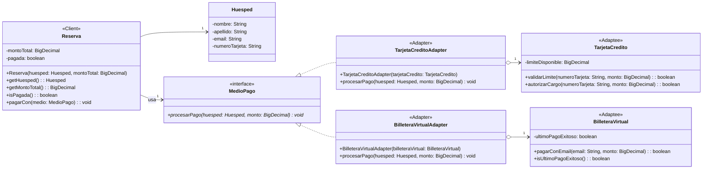

# Consigna 2 — Sistema de Pagos de Reservas de Hotel

## 1. Identificación del Patrón de Diseño
* **Patrón detectado:** **Adapter** (GoF — Patrón Estructural, variante de Objetos).

## 2. Justificación Técnica
La consigna establece que el hotel debe permitir pagar sus reservas mediante diferentes medios (`TarjetaCredito` y `BilleteraVirtual`), pero impone una restricción arquitectónica determinante:
> *"Las clases de los medios de pago ya existen (TarjetaCredito y BilleteraVirtual) y no pueden modificarse. El sistema debe permitir que la reserva se pague con cualquiera de los medios de pago disponibles, sin alterar la estructura de las clases existentes."*

* **Por qué Adapter:**
  1. **Incompatibilidad de interfaces:** `Reserva` espera invocar un método polimórfico uniforme (`pagarCon(...)`). Sin embargo:
     - `TarjetaCredito` requiere dos pasos (`validarLimite(numeroTarjeta, monto)` y luego `autorizarCargo(numeroTarjeta, monto)`).
     - `BilleteraVirtual` requiere un método totalmente diferente (`pagarConEmail(email, monto)`).
  2. **Reutilización de código legado sin modificarlo:** El patrón Adapter permite envolver clases existentes con interfaces incompatibles dentro de adaptadores (`TarjetaCreditoAdapter` y `BilleteraVirtualAdapter`) que implementan la interfaz esperada por el cliente (`MedioPago`).
  3. **Composición sobre herencia (Object Adapter):** Los adaptadores contienen una referencia al objeto adaptado (*Adaptee*), delegando la llamada real previa transformación o traducción de los parámetros requeridos.

---

## 3. Diagrama de Clases UML Formal

---

## 4. Participantes y Estereotipos

* **`<<Client>>` (`Reserva`):** Colabora únicamente a través de la interfaz `MedioPago`, permaneciendo completamente desacoplado de las librerías o clases de pagos externas.
* **`<<Target>>` (`MedioPago`):** Define el protocolo estándar del dominio que el cliente comprende (`procesarPago(huesped, monto)`).
* **`<<Adaptee>>` (`TarjetaCredito`, `BilleteraVirtual`):** Clases existentes del sistema con interfaces incompatibles que no pueden ser alteradas.
* **`<<Adapter>>` (`TarjetaCreditoAdapter`, `BilleteraVirtualAdapter`):** Implementan `MedioPago` y encapsulan la llamada a los métodos específicos de cada medio existente.
