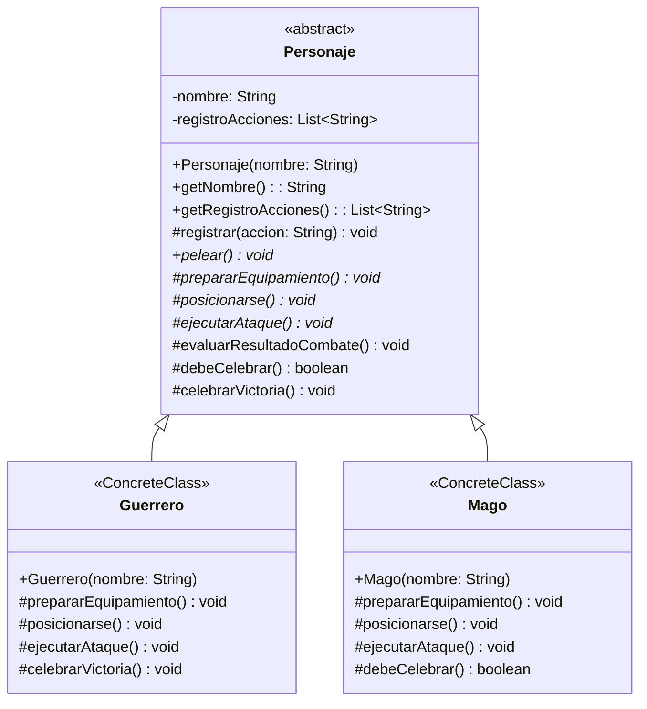

# Consigna 3 — Sistema de Combate en Videojuego de Fantasía

## 1. Identificación del Patrón de Diseño
* **Patrón detectado:** **Template Method** (GoF — Patrón de Comportamiento).

## 2. Justificación Técnica
La consigna describe un proceso de combate con pasos compartidos y pasos con implementaciones específicas según la clase del personaje (`Mago` y `Guerrero`).

El requisito fundamental indica:
> *"A partir de las secuencias de preparación y ejecución de los combates... diseñá una solución que permita representar ambos comportamientos, considerando las similitudes y diferencias entre sus respectivos procedimientos. La solución deberá permitir incorporar nuevos tipos de personajes sin necesidad de modificar la lógica general del proceso de combate."*

* **Por qué Template Method:**
  1. **Esqueleto de algoritmo invariante:** La superclase `Personaje` define el método plantilla `pelear()` como `final`, orquestando la secuencia invariable de preparación, posicionamiento, ataque, evaluación y celebración.
  2. **Inversión de Control (Principio de Hollywood):** La superclase gobierna el flujo y delega la ejecución de los pasos primitivos (`prepararEquipamiento`, `posicionarse`, `ejecutarAtaque`) en las subclases concretas.
  3. **Puntos de extensión mediante Hooks:** Se agrega `debeCelebrar()` y `celebrarVictoria()` para dar flexibilidad a nuevos personajes sin romper la estructura común.

---

## 3. Diagrama de Clases UML Formal

---

## 4. Respuestas a las 6 Preguntas Teóricas
El desarrollo exhaustivo de las preguntas sobre Inversión de Control, Hooks y redefinición del esqueleto se encuentra documentado en [docs/respuestas-teoricas/03-template-method-respuestas.md](file:///home/axel/Escritorio/UTN/M%20de%20Sistemas%20II/parcial-2/docs/respuestas-teoricas/03-template-method-respuestas.md).
