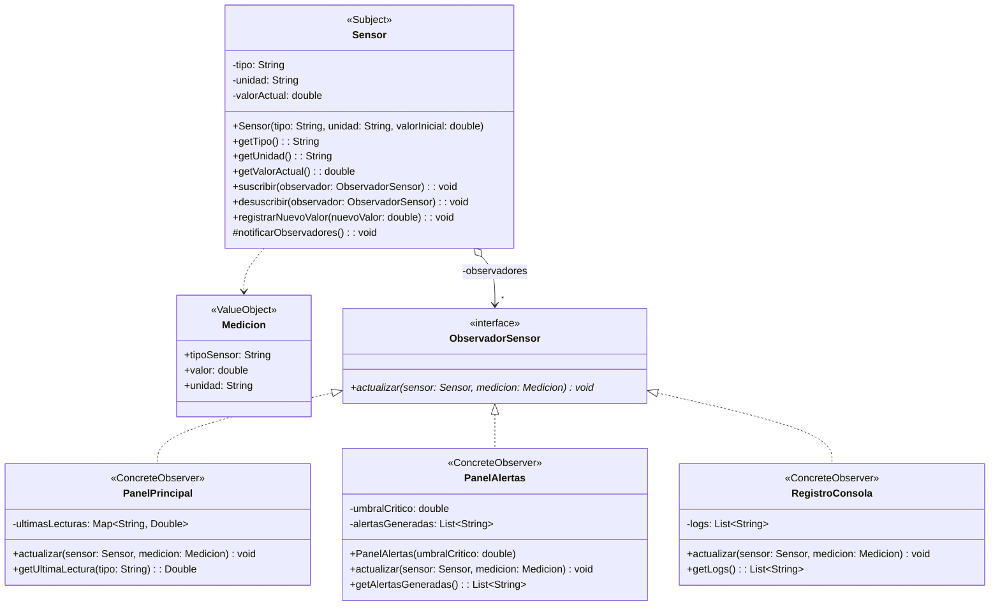

# Consigna 4 — Sistema de Monitoreo Ambiental en Edificio Inteligente

## 1. Identificación del Patrón de Diseño
* **Patrón detectado:** **Observer** (GoF — Patrón de Comportamiento).

## 2. Justificación Técnica
La consigna describe un sistema en el que múltiples paneles visuales y consolas deben reaccionar inmediatamente a los cambios de estado producidos en diversos sensores ambientales independientes (temperatura, humedad, CO2, luminosidad).

El requerimiento determinante es:
> *"Cada vez que un sensor registra un nuevo valor, las vistas o paneles asociados deben actualizarse automáticamente sin intervención del usuario. Los usuarios del sistema pueden activar o desactivar en tiempo real qué paneles o vistas desean que reciban las actualizaciones de cada sensor. Se debe considerar la posibilidad de incorporar nuevos tipos de sensores y nuevos tipos de paneles visuales sin modificar el código existente del sistema."*

* **Por qué Observer:**
  1. **Dependencia uno a muchos desacoplada:** Define una relación 1 a N entre el sujeto observable (`Sensor`) y múltiples observadores (`ObservadorSensor`) sin que el sensor conozca la clase concreta de los paneles.
  2. **Gestión dinámica de suscripciones:** Provee métodos `suscribir(...)` y `desuscribir(...)` que permiten asociar o desvincular vistas en tiempo de ejecución según el deseo del usuario.
  3. **Extensibilidad (Principio Open/Closed):** Permite añadir nuevos tipos de sensores o nuevos tipos de paneles (ej. panel móvil, registro en base de datos) simplemente implementando `ObservadorSensor` sin alterar las clases existentes.

---

## 3. Diagrama de Clases UML Formal

---

## 4. Participantes y Estereotipos

* **`<<Subject>>` (`Sensor`):** Mantiene la lista de observadores suscritos y dispara `notificarObservadores()` ante cada cambio de valor en la variable física.
* **`<<Observer>>` (`ObservadorSensor`):** Interfaz común que define el contrato `actualizar(sensor, medicion)` que todo panel o suscriptor debe cumplir.
* **`<<ConcreteObserver>>` (`PanelPrincipal`, `PanelAlertas`, `RegistroConsola`):** Paneles y componentes gráficos que reaccionan de forma particular al recibir los nuevos valores.
* **`<<ValueObject>>` (`Medicion`):** Contenedor inmutable de datos que transporta la lectura (tipo, valor, unidad).

