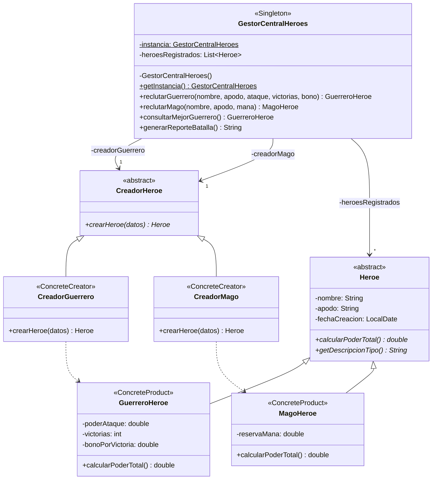

# Consigna 5 — Sistema de Reclutamiento y Gestión de Héroes de Fantasía

## 1. Identificación de los Patrones de Diseño Detectados
Esta consigna requiere una **arquitectura combinada** de tres patrones del GoF para resolver distintas necesidades funcionales y no funcionales:
1. **Factory Method (Patrón Creacional):** Para la creación desacoplada de personajes (`Guerrero` y `Mago`) de acuerdo con sus atributos particulares.
2. **Singleton (Patrón Creacional):** Para garantizar un único gestor central compartido por todos los gremios del reino.
3. **Facade (Patrón Estructural):** Para ofrecer una interfaz simple y unificada que oculte la complejidad del subsistema de creación, consulta y reportes.

---

## 2. Justificación de las Decisiones de Diseño (Requisitos 1 al 4)

### Requisito 1: Creación de diferentes tipos de personajes extensible a futuro
* **Patrón aplicado:** **Factory Method**.
* **Justificación:** Los gremios no deben conocer los detalles constructivos ni las clases concretas de cada héroe. Al delegar la instanciación en la jerarquía `CreadorHeroe` (`CreadorGuerrero`, `CreadorMago`), si mañana se añade un nuevo tipo de héroe (ej. `Arquero` o `Nigromante`), solo se crea su clase `ArqueroHeroe` y su factoría `CreadorArquero` sin tocar el código cliente de los gremios (**Principio Open/Closed**).

### Requisito 2: Garantizar que todos los gremios accedan al mismo gestor central
* **Patrón aplicado:** **Singleton**.
* **Justificación:** Se debe evitar la existencia de múltiples instancias dispersas para no duplicar datos ni perder la consistencia del ranking de héroes. Mediante un constructor privado y el método estático `getInstancia()` con *thread-safety*, todos los gremios acceden y operan sobre el mismo estado compartido en memoria.

### Requisito 3: Proporcionar una interfaz de acceso sencilla para los gremios
* **Patrón aplicado:** **Facade**.
* **Justificación:** Los gremios solo quieren realizar tres operaciones de alto nivel: reclutar héroes, consultar el mejor guerrero y generar reportes. La clase `GestorCentralHeroes` actúa como Fachada unificada, coordinando las factorías, los filtros y la consolidación de reportes de batalla, ocultando el acoplamiento con las clases internas.

### Requisito 4: Reducción del acoplamiento, mantenibilidad y extensión
* **Bajo Acoplamiento:** Los gremios solo se acoplan a los métodos de la fachada (`GestorCentralHeroes`). No conocen los creadores concretos ni las clases específicas de los héroes.
* **Alta Cohesión:** Cada clase tiene una única responsabilidad: las factorías crean, los héroes calculan su poder y la fachada coordina.
* **Facilidad de Mantenimiento:** La lógica de cálculo del mejor guerrero o generación de reportes se modifica en un único lugar sin afectar a los consumidores externos.

---

## 3. Diagrama de Clases UML Formal

