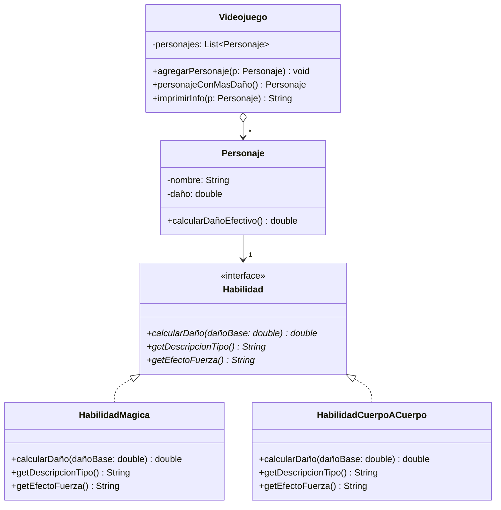

# Consigna 6 — Refactoring del Código de Videojuego

## 1. Resumen de la Refactorización
El ejercicio parte de un código en `Videojuego` que inspecciona la clase concreta de la habilidad (`getClass() == HabilidadMagica.class`) mediante un condicional `if/else`.

Se aplicó la refactorización **Replace Conditional with Polymorphism** recomendada por Martin Fowler:
* Se creó la interfaz polimórfica `Habilidad`.
* Se trasladó la lógica condicional y las cadenas de texto hacia `HabilidadMagica` y `HabilidadCuerpoACuerpo`.
* Se limpiaron los métodos `personajeConMasDaño()` e `imprimirInfo(Personaje p)`, eliminando por completo cualquier estructura condicional y respetando el principio **Tell, Don't Ask**.

---

## 2. Diagrama de Clases UML de la Solución Refactorizada

---

## 3. Respuestas Detalladas a las Preguntas 1 a 4
Las 4 respuestas teóricas obligatorias sobre bad smells, mantenibilidad y técnicas aplicadas se encuentran en [docs/respuestas-teoricas/06-refactoring-analisis.md](file:///home/axel/Escritorio/UTN/M%20de%20Sistemas%20II/parcial-2/docs/respuestas-teoricas/06-refactoring-analisis.md).

